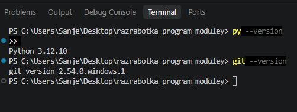

# Домашнее задание № 1
**Студент:** Иваненко Данил
**Группа:** 9/2-РПО-25/1  

---

## 1. Разбор знакомого сервиса: Яндекс Еда

### Действие 1: Добавление товара в корзину
* **Что уходит на сервер (запрос):** ID пользователя из токена, ID блюда, ID ресторана и количество (1 шт.).
* **Что сервер проверяет:** Авторизован ли пользователь, работает ли ресторан сейчас, есть ли это блюдо в меню.
* **Куда это сохраняется:** Записывается в базу данных в таблицу корзины этого пользователя.
* **Что возвращается обратно (ответ):** Статус успешного добавления (код 200) и обновленная сумма корзины для экрана.

### Действие 2: Оформление и оплата заказа
* **Что уходит на сервер (запрос):** ID корзины, адрес доставки, выбранный способ оплаты, сумма к списанию.
* **Что сервер проверяет:** Не изменились ли цены, привязана ли карта, доступен ли курьер на этот адрес.
* **Куда это сохраняется:** Создается новая запись в таблице заказов со статусом "Создан/Оплачивается", корзина очищается.
* **Что возвращается обратно (ответ):** Ссылка на платежный шлюз или статус успешной оплаты (код 201), запуск фоновой задачи для ресторана.

### Действие 3: Отмена заказа пользователем
* **Что уходит на сервер (запрос):** ID заказа, ID пользователя, причина отмены.
* **Что сервер проверяет:** Принадлежит ли заказ этому юзеру, не начал ли ресторан уже готовить еду (бизнес-логика: отмена возможна только первые пару минут).
* **Куда это сохраняется:** В базе данных статус заказа меняется на "Отменен".
* **Что возвращается обратно (ответ):** Статус отмены, информация о возврате денег (или отказ с кодом 403, если готовить уже начали).

---

## 2. Место для отказа
* **Выбранное действие:** Действие 1 — Добавление товара в корзину.
* **Что сломается при сбоях:** 
  1. *Если пропадет сеть:* Запрос до сервера может дойти (товар добавится), но телефон ответ не получит. На экране пользователя корзина останется пустой, возникнет рассинхронизация.
  2. *Если нажать кнопку дважды:* Уйдут два запроса. Если бэкенд не проверяет повторы (идемпотентность), в корзину добавятся две порции вместо одной.
  3. *Если отправить пустое поле:* Если отправить пустой ID блюда, сервер должен отсечь его ошибкой 422 (валидация). Если бэкенд написан плохо, он упадет с ошибкой 500.
* **Поведение приложения на практике:** Приложение "Яндекс Еда" при нажатии на плюс блокирует кнопку на долю секунды, не давая нажать дважды. При потере сети пишет "Сеть пропала", но не сбрасывает то, что уже было на экране.

---

## 3. Сборка окружения
* **Версия Python:** Python 3.12.10
* **Версия Git:** git version 2.54.0.windows.1
* **Ошибки и проблемы при установке:** Окружение настроено, программы установлены и готовы к работе.

###  Подтверждение успешной настройки из терминала VS Code:

