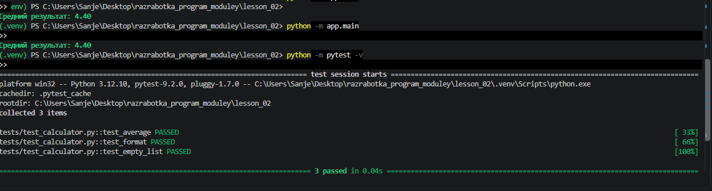

# Домашнее задание № 2: Структура Python-проекта

##  Выполненная работа
1. Создано и активировано изолированное виртуальное окружение `.venv`.
2. Архивы проекта очищены от неиспользуемых файлов (удалена папка `go`).
3. Файлы переименованы из русскоязычного расширения `.ру` в стандартный формат `.py`.
4. Код успешно реструктурирован согласно ТЗ: логика вынесена в `app/services`, тесты — в папку `tests`.
5. Добавлены пустые файлы-маркеры `__init__.py` для инициализации модулей.
6. В файлах `main.py` и `test_calculator.py` исправлены импорты (модуль `utils` заменен на `services`).
7. Успешно установлены зависимости из файла `requirements.txt`.

---

##  Результаты запуска программы и тестов:
Вывод приложения с использованием библиотеки `Rich` и отчёт тестировщика `pytest`:

