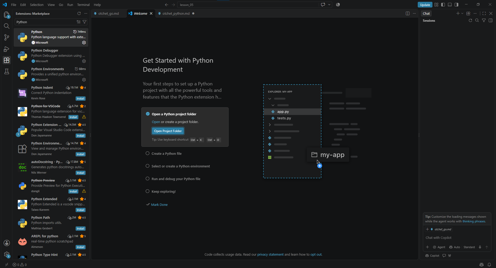
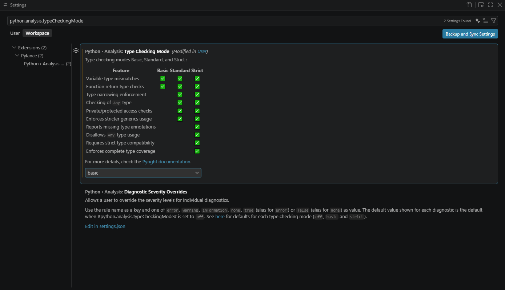
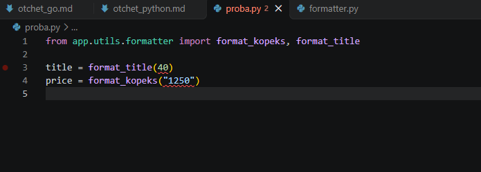
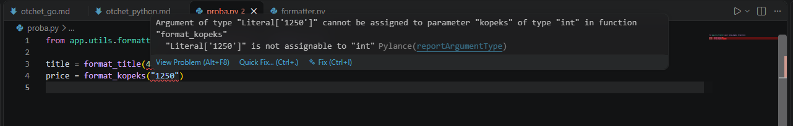
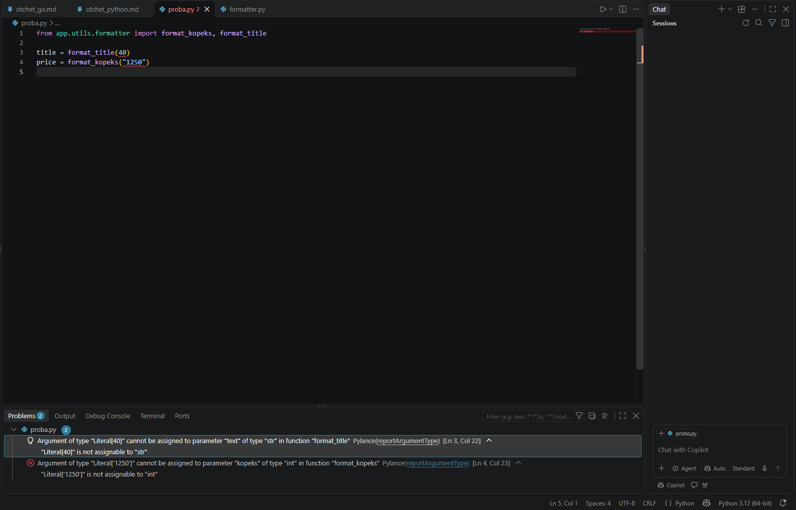
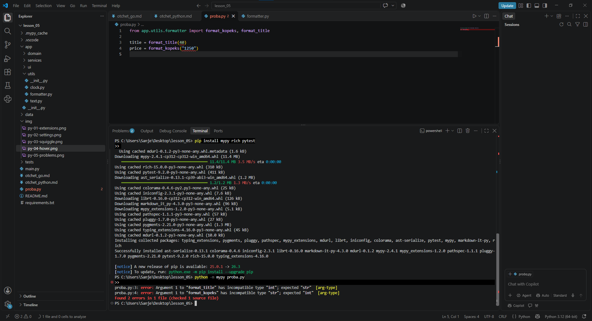
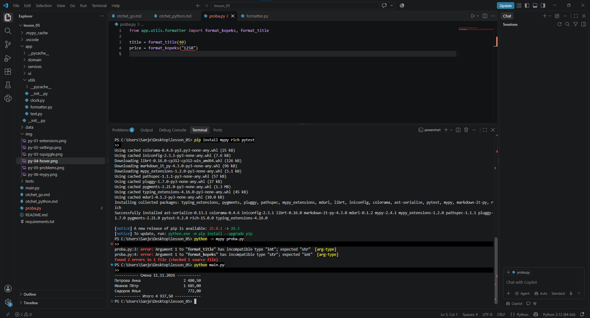

# Отчёт о лабораторной работе: Статический анализ и проверка типов
**Студент:** Иваненко Данил
**Группа:** 9/2-РПО-25/1
**Вариант:** Python  

---

## Глава 1. Настройка окружения
В рамках лабораторной работы в среде разработки VS Code было успешно установлено и активировано расширение **Python** (включающее языковой сервер **Pylance**). 

В настройках рабочей области (`Workspace Settings`) был принудительно включен базовый режим проверки типов с помощью параметра `"python.analysis.typeCheckingMode": "basic"`.

---

## Глава 2. Проверка типов в редакторе
Для проведения опытов был создан скрипт `proba.py`, содержащий намеренные ошибки передачи неверных типов данных в функции форматирования. Языковой сервер Pylance мгновенно проанализировал код на лету, подсветил ошибочные аргументы волновой линией и вывел подробное описание несовместимости типов как по наведению курсора, так и на системной панели `Problems`.

### Снимки экрана из редактора:
1. **Установленные расширения:**  
   

2. **Настройки режима basic:**  
   

3. **Волнистая линия ошибки (Squiggle):**  
   

4. **Подсказка об ошибке при наведении (Hover):**  
   

5. **Ошибки на панели проблем (Problems):**  
   

---

## Глава 3. Проверка типов в терминале
Для независимой автоматической проверки типов в виртуальное окружение проекта была установлена консольная утилита статического анализа **`mypy`**. При запуске команды статического анализа файла опытов `proba.py` через терминал, утилита успешно перехватила ошибки типов данных и вывела их в стандартный поток вывода с тегом `[arg-type]`.

### Снимок экрана проверки mypy:

---

## Глава 4. Финальные результаты
После проведения опытов все функции модулей логики в папке `app/` были успешно доработаны и дополнены строгими аннотациями типов данных Python. Программа была запущена в изолированном окружении, успешно обработала входные структуры данных кафе и вывела верный финальный расчёт.

### Снимок экрана работающей программы:

**Итоговый результат работы программы:** 4 937,50 ₽.
